# Database design (ERD)

Rasd uses one PostgreSQL database (with the pgvector extension for RAG). The
design has three groups of tables:

1. **Customers and policies:** who the customer is, what they drive, and which insurer covers them.
2. **Tickets:** everything that happens on a request: messages, documents, approvals, submissions to insurers, quotes, payments and the audit log.
3. **Settings and knowledge:** the values staff edit (services, reminders, insurer settings, prices) and the RAG knowledge base.

In Round 1, **Person A** builds groups 1 and 2, and **Person B** builds group 3.

## Diagram

GitHub draws the diagram below. A full-size image is also in [erd.png](erd.png).

```mermaid
erDiagram
    customers ||--o{ vehicles : owns
    customers ||--o{ policies : holds
    vehicles ||--o{ policies : "covered by"
    insurers ||--o{ policies : issues

    customers ||--o{ tickets : opens
    policies |o--o{ tickets : "is about"
    insurers |o--o{ tickets : "handled by"
    services ||--o{ tickets : "type of"
    staff_users |o--o{ tickets : "assigned to"

    tickets ||--o{ messages : has
    tickets ||--o{ documents : has
    messages |o--o{ documents : "arrived with"
    tickets ||--o{ ticket_events : "audit log"
    staff_users |o--o{ ticket_events : "performed by"
    tickets ||--o{ approvals : "needs"
    staff_users ||--o{ approvals : decides
    tickets ||--o{ insurer_submissions : "sent as"
    tickets ||--o{ insurer_quotes : receives
    tickets ||--o{ payments : "paid by"
    approvals |o--o| payments : "approved by"

    services ||--o{ service_required_documents : requires
    services ||--|| reminder_policies : "timed by"
    insurers ||--o{ insurer_settings : "configured by"
    services ||--o{ insurer_settings : "per service"
    insurers ||--o{ prices : charges
    services ||--o{ prices : "priced as"
    prices ||--o{ price_history : "changes logged in"
    staff_users ||--o{ price_history : "changed by"
    insurers |o--o{ knowledge_chunks : "described in"
    services |o--o{ knowledge_chunks : "described in"

    customers {
        bigint id PK
        text full_name
        text phone UK "used to match WhatsApp messages"
        text email
        text civil_id UK
        text preferred_language "ar or en"
        timestamptz created_at
    }
    vehicles {
        bigint id PK
        bigint customer_id FK
        text plate_number
        text chassis_number UK
        text make
        text model
        int year
    }
    insurers {
        bigint id PK
        text code UK
        text name
        boolean is_active
    }
    policies {
        bigint id PK
        text policy_number UK
        bigint customer_id FK
        bigint vehicle_id FK
        bigint insurer_id FK
        text policy_type "comprehensive or third_party"
        date start_date
        date end_date
        boolean has_uae_cover
        text status "active, expired, cancelled"
    }
    staff_users {
        bigint id PK
        text full_name
        text email UK
        text role "agent, supervisor, admin"
        boolean is_active
    }
    tickets {
        bigint id PK
        text ticket_code UK "T-1042, used in email subjects"
        bigint customer_id FK
        bigint policy_id FK "null until identified"
        bigint insurer_id FK
        bigint service_id FK
        bigint assigned_to FK
        text status "see ticket states in spec"
        text priority "low, normal, high"
        numeric classification_confidence
        text graph_thread_id "LangGraph checkpoint thread"
        text temporal_workflow_id
        timestamptz opened_at
        timestamptz due_at
        timestamptz closed_at
        text close_reason
        smallint customer_rating
    }
    messages {
        bigint id PK
        bigint ticket_id FK
        text direction "inbound or outbound"
        text party "customer, insurer, staff, system"
        text channel "whatsapp, email, portal, web"
        text subject
        text body
        text external_id "email Message-ID for threading"
        boolean is_reminder
        timestamptz created_at
    }
    documents {
        bigint id PK
        bigint ticket_id FK
        bigint message_id FK
        text doc_type "registration, id_card, driving_licence, endorsement, screenshot"
        text file_path
        text mime_type
        text ocr_text
        jsonb extracted_fields "name, expiry, plate, civil_id"
        numeric confidence
        text validation_status "pending, valid, invalid"
        jsonb validation_issues
        timestamptz uploaded_at
    }
    ticket_events {
        bigint id PK
        bigint ticket_id FK
        text actor_type "system, ai, staff, customer, insurer"
        bigint staff_id FK
        text event_type
        text from_status
        text to_status
        jsonb details
        timestamptz created_at
    }
    approvals {
        bigint id PK
        bigint ticket_id FK
        text gate "before_insurer or before_payment"
        text decision "approved, edited, rejected"
        bigint staff_id FK
        text original_draft
        text final_draft
        text note
        timestamptz decided_at
    }
    insurer_submissions {
        bigint id PK
        bigint ticket_id FK
        text channel "email or portal"
        smallint round "1 or 2"
        text reference "insurer reference number"
        text status "submitted, pending_insurer_approval, approved, declined"
        smallint reminders_sent
        timestamptz submitted_at
        timestamptz last_checked_at
        timestamptz last_reminder_at
    }
    insurer_quotes {
        bigint id PK
        bigint ticket_id FK
        numeric quoted_amount
        numeric table_amount "price table value at the time"
        boolean differs_from_table
        text status "pending, accepted, rejected"
        timestamptz received_at
    }
    payments {
        bigint id PK
        bigint ticket_id FK
        bigint approval_id FK "gate 2 decision"
        numeric amount
        text currency "OMR"
        text payment_link
        text provider_reference
        text status "pending, paid, expired, failed"
        timestamptz created_at
        timestamptz paid_at
    }
    services {
        bigint id PK
        text code UK "ownership_transfer, uae_extension"
        text name_en
        text name_ar
        boolean is_active
    }
    service_required_documents {
        bigint id PK
        bigint service_id FK
        text doc_type
        boolean is_mandatory
    }
    reminder_policies {
        bigint id PK
        bigint service_id FK, UK
        int poll_every_minutes
        int remind_insurer_after_minutes
        smallint max_insurer_reminders
        int remind_customer_after_minutes
        smallint max_customer_reminders
        int escalate_after_minutes
        timestamptz updated_at
    }
    insurer_settings {
        bigint id PK
        bigint insurer_id FK
        bigint service_id FK
        text channel "email, portal, both"
        boolean needs_insurer_approval
        smallint pricing_rounds "1 or 2"
        boolean round2_needs_staff_approval
        text email_to
        text portal_url
    }
    prices {
        bigint id PK
        bigint insurer_id FK
        bigint service_id FK
        numeric amount
        text currency "OMR"
        timestamptz updated_at
    }
    price_history {
        bigint id PK
        bigint price_id FK
        numeric old_amount
        numeric new_amount
        bigint changed_by FK
        bigint source_ticket_id "quote that triggered the change"
        text reason
        timestamptz changed_at
    }
    knowledge_chunks {
        bigint id PK
        bigint insurer_id FK "null means applies to all"
        bigint service_id FK "null means applies to all"
        text source_file
        text content
        vector embedding "pgvector"
        timestamptz updated_at
    }
```

## Design decisions

- **`tickets.policy_id` can be empty.** A message arrives before the agent knows which policy it is about.
- **`tickets.ticket_code`** (`T-1042`) is separate from the numeric `id`. It goes in email subjects so insurer replies can be matched back to the ticket.
- **`graph_thread_id` and `temporal_workflow_id`** link a ticket to its paused LangGraph run and its Temporal workflow, so both can resume after a restart.
- **`approvals` keeps both drafts.** `original_draft` is what the AI wrote and `final_draft` is what was sent, so you can measure how often staff edit the AI.
- **`payments.approval_id`** points to the gate 2 decision. A payment row without an approval must never exist, and a database constraint should enforce it.
- **`ticket_events` is append-only.** Nothing is updated or deleted there; it is the audit log.
- **Screenshots and endorsements are `documents`** with their own `doc_type`, so all files live in one place.
- **`insurer_quotes.table_amount`** stores the price-table value at the moment the quote arrived, so a price-change alert still makes sense after the table is updated.
- **`reminder_policies` has one row per service** (the unique key on `service_id`). Staff edit these rows; no timing is hard-coded.
- **Short lists are `text` with a check constraint**, not separate lookup tables (status, channel, gate). The allowed values are listed in the comments above and in `docs/spec.md`.

## Indexes to add

- `tickets (status)`, `tickets (insurer_id, status)`, `tickets (due_at)`: the dashboard and the escalation checks read these all the time.
- `messages (external_id)`: matching email replies to tickets.
- `ticket_events (ticket_id, created_at)`: the audit timeline.
- `knowledge_chunks` vector index on `embedding`: RAG lookups.
